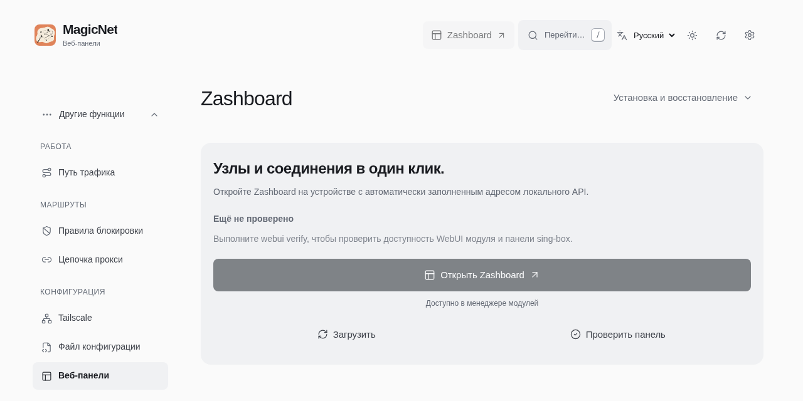
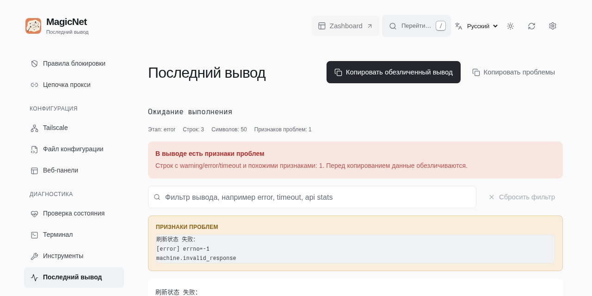

# MagicNet 导航修复与本机验证

日期：2026-11-19（Asia/Taipei）。

## 结论与源码身份

本轮修复桌面深链接、窗口高度变化和语言重排后的当前导航项遮挡。最终源码为 [75da8b3064350dd335844da1957cd45b6c347f9c](https://github.com/LIghtJUNction/magicnet-android/commit/75da8b3064350dd335844da1957cd45b6c347f9c)，受测源码树为 `c12d49b393ee718d2f2340dcabec93db517396cb`。在 ssmcp 开发机上，类型检查、生产构建和 76 项定向浏览器测试通过；另有 2 项既有视口条件跳过，0 失败。原先的完整可见性、页面身份、正文滚动位置和焦点断言全部保留。

源码分两段推送。[4110fc9](https://github.com/LIghtJUNction/magicnet-android/commit/4110fc9a31e57ea76d080e1971e1251220b9548d) 处理异步布局通知并补充回归场景；75da8b3 根据开发机上仍可复现的两项失败，补齐实际滚动容器监听、即时高度和像素取整。GitHub 创建的最终 tree 与开发机受测 tree 逐字相同。主项目同步 gitlink、两个复用工作流、三语 README、当前依赖和配方合同；公开 Android 版本仍为 v1.9.1 / 10619。

## 问题如何发生

当前项能否完整显示，只取决于按钮矩形是否处在侧栏实际可见矩形内。初次深链接中，页面异步挂载和字体加载可能改变布局；只在首次挂载时计算一次不足以覆盖最终尺寸。本轮用合并到动画帧的重新计算，响应页面布局、字体、语言和窗口变化，并在卸载时取消观察和待执行帧。

开发机上的第一次定向回归进一步复现了一个高度变化问题：全局“减少动态效果”样式为所有元素设置非零的 1 毫秒过渡时长，而侧栏的默认过渡属性是 `all`。窗口从 900px 缩为 640px 时，内联最大高度已是 500px，同帧计算样式和实际高度仍为 760px。计算把位于 879.9375px 的“最近输出”按钮视为可见，随后侧栏底部缩到 624px；导航内容和正文总高度没有变化，原观察目标没有再次通知。修复为侧栏明确设置 `transition-property: none`，同时观察侧栏自身尺寸。

俄语文本重排还暴露了小数像素边界：按钮底部为 624.09375px，侧栏底部为 624px，滚动偏移却取整为 317px，导致可见比例为 0.997869。修复按实际滚动区域计算边界，保留 1px 内缩余量并对滚动增量向上取整。只调整侧栏滚动，正文位置和键盘焦点不变。

## 实际执行结果

两个浏览器批次使用相同的三份测试文件、六种视口、系统 Chromium 和 `reducedMotion: reduce`，重试次数为 0。后一次没有降低断言或增加任意等待来换取通过。

| 批次 | 源码 | 通过 | 跳过 | 失败 |
| --- | --- | ---: | ---: | ---: |
| 首次本机定向回归 | 4110fc9 | 74 | 2 | 2 |
| 修复后本机定向回归 | 75da8b3 对应的完整源码树 | 76 | 2 | 0 |

两个首次失败分别为：桌面 `/#/output` 缩短窗口后当前项完全在视口外；桌面 `/#/webui` 切换俄语后被裁切不足 1px。修复后的布局采样中，侧栏底部均为 624px；俄语 webui 按钮底部为 622.09375px，output 为 622.28125px；两页正文 `scrollY=0`，侧栏计算样式 `transitionProperty=none`。

| 视口 | 初始尺寸 | 最终批次结果 |
| --- | --- | --- |
| narrow-320 | 320×740 | 13 通过 |
| phone-360 | 360×800 | 13 通过 |
| phone-390 | 390×844 | 13 通过 |
| phone-430 | 430×932 | 13 通过 |
| landscape | 844×390 | 12 通过、1 跳过 |
| desktop | 1280×900；深链接另缩至 1280×640 | 12 通过、1 跳过 |

两项跳过来自既有“手机空终端输入及执行按钮位于底栏上方”测试的视口条件，未计为通过。覆盖范围包括中英文/俄文标签、14 页逐页翻译检查、未保存配置草稿、长页后的显式切页、深链接、快捷入口及弹层焦点恢复；这 78 项是定向测试组，不代表整个浏览器套件或 Android WebView 已全量验收。

最终两文件补丁的类型检查和生产构建均在开发机通过；`git diff --check` 通过。完整配方检查、打包、归档检查和提示词生成通过 8 个包 / 62 份 Markdown；结果见[结构化证据](evidence/navigation-2026-11-19.json)；验收合同对应 web-console 的 UI-NAV-001–002 与根包 M73。

## 截图与证据

以下截图来自本机浏览器预览，未接入 KernelSU bridge，因此功能禁用和机器接口不可用提示属于预览环境。图片证明布局，不证明设备网络或后端动作成功。





[JSON 证据](evidence/navigation-2026-11-19.json)记录源码树、命令、分批计数、布局数值及日志摘要。完整原始日志和失败痕迹保存在开发机 `artifacts/iteration-20261119-navigation/`，首次失败未被覆盖。截图仅保留用于说明问题的两张，避免把完整浏览器产物复制进仓库。

## 复现

在源码仓库检出 75da8b3 后：

```bash
cd webui
npm ci
npm run typecheck
npm run build
CI=1 MAGICNET_WEBUI_PORT=4198 PLAYWRIGHT_CHROMIUM_EXECUTABLE_PATH=/usr/bin/chromium \
  npm run test:ui -- e2e/navigation-layout.spec.mjs \
  e2e/navigation-usability.spec.mjs e2e/i18n.spec.mjs --workers=4
```

主仓整合后运行 `python3 scripts/check-recipes.py`，检查当前源码 pin、配方检查、打包、归档检查及完整构建提示词。日常验收使用开发机结果；本轮后续提交带 `[skip ci]`，没有以等待远程自动测试替代本机验证。

## 范围边界

本节只证明所列源码树的浏览器行为与构建结果。完整模块包、真实手机安装、运行中的资源身份及应用联网结果由独立设备流程记录，不从浏览器截图外推。公开发布身份、既有 #436 故障恢复结论及历史失败记录保持各自的证据范围。
