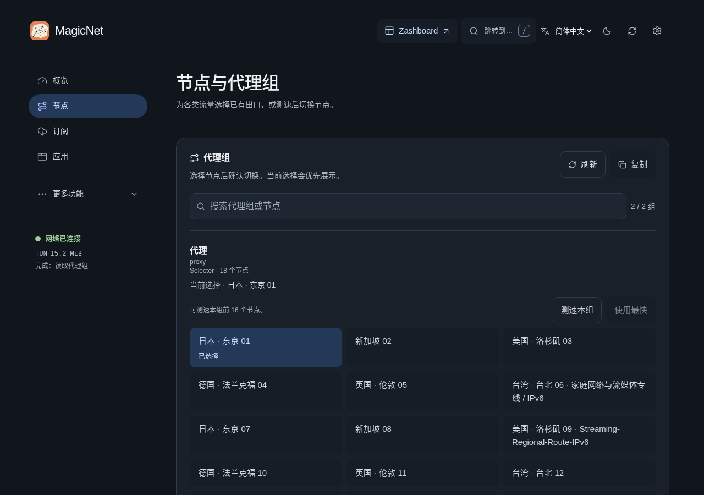

# MagicNet 节点列表与前端修复报告

日期：2026-11-18（Asia/Taipei）。CI 快照：20:24:52（UTC+08:00）。

## 交付结果

节点列表、节点页刷新和共享界面改进已分阶段推送。最终源码为 [fa0de2e1](https://github.com/LIghtJUNction/magicnet-android/commit/fa0de2e137b9f54d31628b5d899001fb11be8a13)，tree `af6c70d744cff4682bff41f53a049d213ce0fbd0`；主仓集成截至 [09256c46](https://github.com/LIghtJUNction/MagicNet/commit/09256c46388a596f65c033aa7bee91be81812989)。产品、控制面、WebUI 配方分别为 **0.3.34 / 0.2.14 / 0.2.12**，网络运行时保持 0.1.20。

| 提交 | 内容 |
| --- | --- |
| [c2ccbd3e](https://github.com/LIghtJUNction/magicnet-android/commit/c2ccbd3e03e4757a88fc342018449676a22ca224) | 诊断导出隐私测试区分私密 UID 与正常公开数值 |
| [a432d32c](https://github.com/LIghtJUNction/magicnet-android/commit/a432d32c59a613e33bcb79d49bdd859f5d7a0a7f) | 返回缓存节点页时重新读取核心代理组，拒绝旧响应覆盖 |
| [dc90cdd0](https://github.com/LIghtJUNction/magicnet-android/commit/dc90cdd0d7978d02773f93f7ffa4a34f5637e89b) | 统一设置面板、导航、表单与浅深主题层次 |
| [fa0de2e1](https://github.com/LIghtJUNction/magicnet-android/commit/fa0de2e137b9f54d31628b5d899001fb11be8a13) | 当前配置决定节点列表，旧工作标签不再抢占上限 |

## 为什么排除后反而只剩那些节点

用 HK、JP、US 三个合成节点运行实际过滤与配置安装路径，排除 HK 后，当前配置和已提交工作出站均为 JP/US，排除方向正确。问题出在列表读取：旧实现先读遗留的 `subscription-work/tags.txt`，达到默认 48 条就直接返回。

将 48 条旧 HK 标签放入该文件后，真实 CLI 的结果全部是 HK，当前配置中的 JP/US 完全不出现。永久回归在修复前实际 exit 101；修复后只返回 JP/US。列表现在从精确的当前配置读取，保留成员限制、去重和上限，暂存候选不参与。

| 当前配置 | 列表行为 |
| --- | --- |
| 含有效代理节点 | 返回当前节点，并更新既有缓存 |
| 对象省略 outbounds、设为 null、空数组或只有非代理出站 | 返回空列表，清除旧节点缓存 |
| 配置缺失、不可读、JSON 无效、根非对象或 outbounds 类型错误 | 保留既有可选缓存回退；MAGICNET_NODE_CACHE=0 可关闭 |

省略或 null 的处理有固定 sing-box 源码依据，并与宿主 sing-box 1.14.4 的实际配置检查一致。额外边界的单独 fail-first 因编译队列在断言前取消，没有计为失败证据；最终 9 项测试已包含这些边界并全部通过。

合成验证覆盖原生导入、实际构建与 sanitize 过滤、配置安装、work 提交、Rust 列表以及候选检查失败保留原配置。Proxylink 路径使用转换器夹具输出，核心接受和 lifecycle/journal 也使用夹具；不能据此宣称真实转换器解析、完整设备回滚或真机联网已通过。

## 节点页缓存也已修复

真实 Vue KeepAlive 与实际代理组组件可以重现另一条路径：先显示 HK/JP，离页后核心变为 JP/US，返回时页面仍显示旧快照，找不到 US。修改前浏览器回归 exit 1。

现在返回已加载的节点页会重新读取核心代理组。首次显示仍只有一次请求；离页或卸载后的晚响应、旧测速结果不会覆盖新快照。返回时如果旧请求尚未结束，结束后只补一次新读取。搜索和展开状态保留，只有最新快照中失效或已经选中的待确认选择才取消。共享延迟加载机制与设备写操作流程保持原合同。

## 前端改进

共享样式采用浅灰蓝画布和单层轻描边设置面板，嵌套内容保持平面；统一导航选中态、标题节奏、留白、输入和次要按钮。深色主题同步调整，触控、键盘焦点、减少动画和原有页面功能保留。辅助文字对比度检查发现的一处不足已修正，最终检查最低为 4.73:1。

以下截图使用合成 bridge 数据，仅表示浏览器视觉结果。

### 手机订阅排除区

### 桌面深色节点页

## 验证记录

| 验证 | 实际结果 |
| --- | --- |
| 最终 nodes::tests，包含缺字段/null 边界 | 9 passed，exit 0 |
| diagnostic_export 完整组 | 3 passed，exit 0 |
| WebUI npm run check | 399 项测试、类型检查、生产构建通过 |
| 节点页新增及既有回归，桌面/手机 | 10 次场景执行通过 |
| 导航与交互回归 | 44 通过；1 项手机专属检查在桌面跳过 |
| 表单页面、手机/桌面、浅深主题 | 20 通过 |
| 合成节点长列表视觉检查 | 4 组尺寸/主题；22 个节点；无横向溢出或页面错误；节点最小高度 48px |
| 配方 check、pack、归档 check、完整提示词 | 8 包、62 份 Markdown 通过 |
| 诊断测试 Clippy、源码格式和差异检查 | 通过 |

浏览器表中是各批次的执行次数，不宣称全部互不重复。此前热点与 TUN 修复的 97 项分组结果及完整主机 fake Magisk 流程见[上一份报告](tun-generation-hotspot-gate-2026-11-18.md)，不重复计入本表。

诊断导出的旧质量检查 [44293729890](https://github.com/LIghtJUNction/magicnet-android/actions/runs/44293729890) 在全报告搜索数字 10112 时失败。公开 MTU 设置为相同数值可确定性重现误判；修复后精确验证 UID 字段只输出 present/count，并确认公开数值仍保留，所有字符串秘密 canary 检查继续执行。原 CI 未保存实际命中字段，不能声称已经确定那一次匹配发生在内存或 uptime 字段，也没有据此修改生产脱敏逻辑。

复查主要命令：

~~~bash
cargo test --locked -p magicnet-cli --bin magicnet-cli nodes::tests
cargo test --locked -p magicnet-cli --test diagnostic_export
cd webui
npm run check
~~~

浏览器专门回归使用 e2e/proxy-groups-refresh.spec.mjs、proxy-groups.spec.mjs 和 proxy-group-names.spec.mjs；设备和真实订阅结果另记。

## CI、Issue 与版本边界

以下快照只对应最终源码 fa0de2e1，不能用较早提交的绿色结果代替：

| 工作流 | 20:24:52 快照 |
| --- | --- |
| [Code Quality](https://github.com/LIghtJUNction/magicnet-android/actions/runs/44301604401) | success |
| [Network Regression Evidence](https://github.com/LIghtJUNction/magicnet-android/actions/runs/44301604495) | in_progress |
| [Android KernelSU Acceptance](https://github.com/LIghtJUNction/magicnet-android/actions/runs/44301604370) | in_progress |
| [Build MagicNet source](https://github.com/LIghtJUNction/magicnet-android/actions/runs/44301604460) | in_progress |

已核对开放的 [Issue #436](https://github.com/LIghtJUNction/MagicNet/issues/436)。前半轮继续补强 TUN 缓存与当前核心代际的一致性；该 Issue 中 OEM 路由规则消失的触发者仍需要受控设备证据，所以保持开放，不能把列表或状态显示修复写成现场根因已消除。

集成完整保留并行提交 df985db1 的 v1.9.1 发布说明、设备证据、验证历史和三语说明。那批真机证据属于源码 5169e071 的候选；本轮没有安装新代码或另发版本。当前公开 v1.9.1 / 10619 安装包不包含这里的新提交，后续正式交付仍需对应源码的质量、构建和 Android 门禁。

## 复核

复核已覆盖：可观察贡献、解释清晰度、实验强度、场景覆盖和设计一致性。当前配置与核心运行快照分开描述；原始失败、最终通过、浏览器夹具、设备证据和发行身份分别记录。源码与配方均经独立只读复核，发现的空配置和视觉合同遗漏已补齐。
