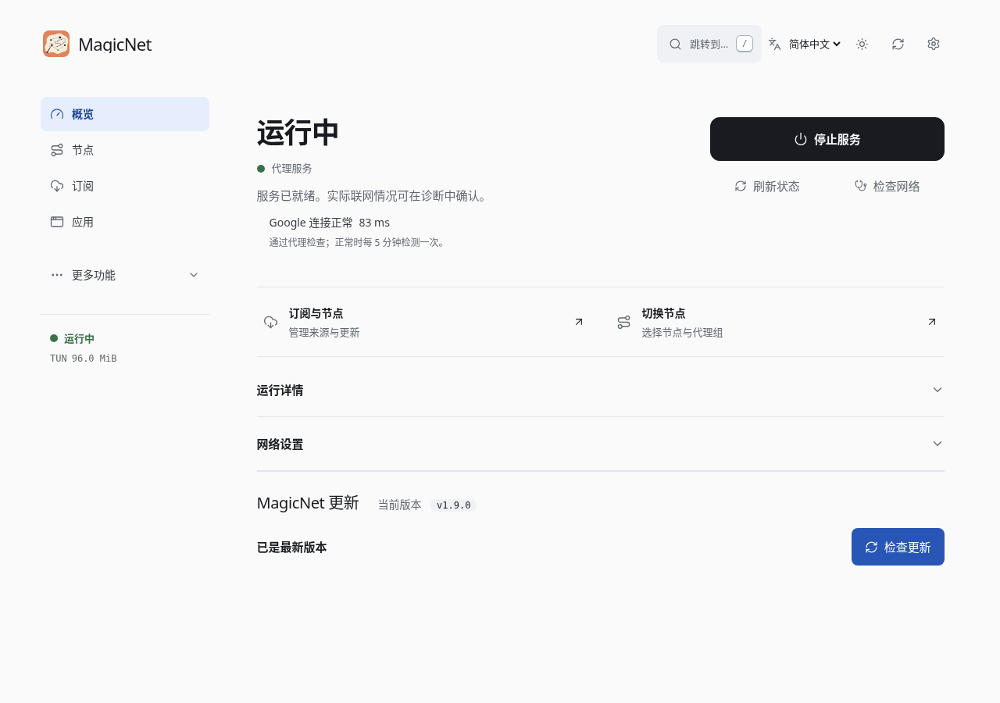
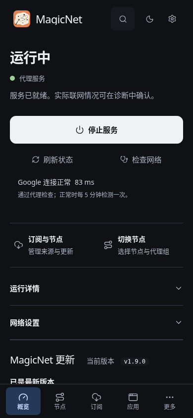

# v1.9.0 界面预览

以下截图使用只读模拟桥接数据：服务就绪、TUN 模式及 HTTPS 延迟均为夹具值，未执行设备操作。截图用于检查布局与信息层级，不是物理手机联网、安装或正式发行的证据。

## 桌面浅色

1280×900。四个日常入口直接可达，其余十页位于“更多功能”；运行详情和网络设置默认折叠。

## 手机深色

390×844。底部四项日常导航加“更多”，启动或停止、刷新状态、检查网络位于概览上方。

浏览器：官方 Chrome for Testing 157.0.8103.78。对应源码：`1e91457e5a04d96fc0604728a512333477a63376`。
