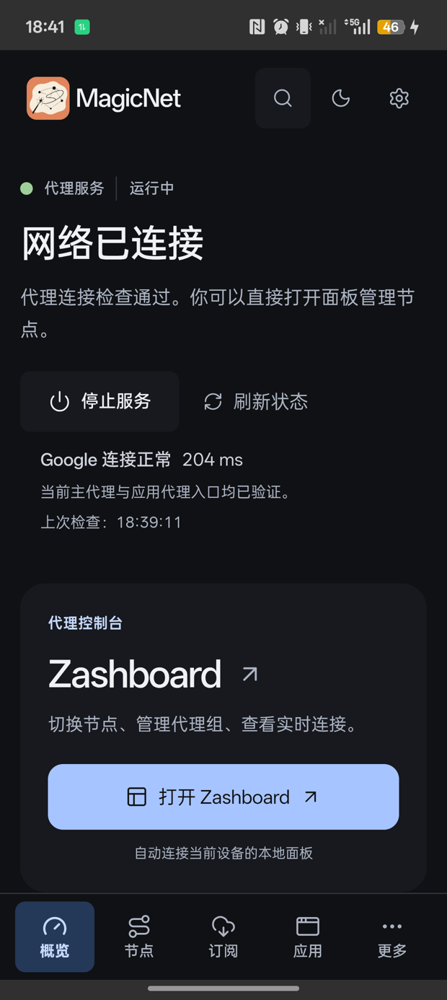

# MagicNet v1.9.1：发布与真机验收

更新日期：2026-11-18（Asia/Taipei）。

**v1.9.1 / 10619 已正式发布。** 本轮发布源码固定为 [5169e071](https://github.com/LIghtJUNction/magicnet-android/commit/5169e07155a47d16f3c5e610a8aa368cc2d08b02)。一台 ARM64 手机已从 v1.8.9 升级到同源码的本地验收构建；正式发布包和本地构建分别记录身份。

[正式发行](https://github.com/LIghtJUNction/MagicNet/releases/tag/v1.9.1) · [完整离线安装包](https://github.com/LIghtJUNction/MagicNet/releases/download/v1.9.1/MagicNet-full.zip) · [验证记录](../../recipes/magicnet/VERIFICATION.md) · [脱敏真机证据](../evidence/magicnet-v1.9.1-device.json) · [公开下载核验](../evidence/publication-verification-v1.9.1.json)

## 这次改了什么

首页把代理进程状态与联网结果分开，主要操作集中在首屏。新增醒目的 **打开 Zashboard** 按钮，手机竖屏、横屏和桌面均保留可识别的入口。启动器先检查本地 API 与面板文件，再打开当前设备的本地面板，并带入 hostname/port 设置；只接受预期的回环地址和面板路径。TUN 未就绪时仍可进入面板排查。此项对应 [#457](https://github.com/LIghtJUNction/MagicNet/issues/457)。

订阅过滤标签明确写为“排除”，清空操作先修改草稿，再由保存应用生效，减少误删可用节点的风险。管理页把日常入口放在前面，维护操作折叠，中、英、俄三种语言同步。已修复按节点名称中的 fail 字样误报失败的问题。

网络观察进一步区分“规则确定存在”和“无法判断”：非零或未知 TOS/DS 条件路由不会被当作覆盖普通流量的无条件路由，明确零值继续按默认匹配处理。未知证据不会增加自动重启权限。后续主分支的范围、热点与核心代际修复有各自源码和验证记录，未回填为本发布包的功能。

## 实际验证

| 范围 | 结果 |
| --- | --- |
| WebUI 单元、类型与构建 | 399 项通过；typecheck、build 通过 |
| 浏览器回归 | 865 通过、5 项既有视口条件跳过、0 失败 |
| 发布源码 CI | Quality、Build、Network、Android 四项通过 |
| 正式 Android 模拟器 | 13/13 阶段、5/5 重启通过；受控丢规则后恢复、上联重连和夹具还原通过 |
| ARM64 真机升级 | 安装退出码 0；重启后版本生效，CLI/core 与本地候选哈希一致 |
| 真机配置与联网 | 订阅、过滤设置、节点选择在升级前后保持；前台普通应用 UID 对 Google、Cloudflare 的 HTTPS 请求取得 204 |
| 真机 WebUI | 354 × 736 CSS 视口，14 页导航通过；未见致命页面错误、横向溢出，页面切换回到顶部 |
| Zashboard | 物理点击成功，Chrome 打开回环面板；观察到 hostname/port 设置意图，页面中 3 个节点与本地 API 数据匹配 |
| 蜂窝重连 | 断开 10 秒后恢复，观察 180 秒；应用两目标 204、TUN present，但严格探测出现 endpoint_specific / degraded，整项保留 needs_review |
| 公开下载 | 无认证实际下载，HTTP 200；SHA256 与清单、GitHub digest 一致，364 文件 CRC 通过、无重复成员 |

源码 CI：[Quality](https://github.com/LIghtJUNction/magicnet-android/actions/runs/44280408002)、[Build](https://github.com/LIghtJUNction/magicnet-android/actions/runs/44280408154)、[Network](https://github.com/LIghtJUNction/magicnet-android/actions/runs/44280407987)、[Android](https://github.com/LIghtJUNction/magicnet-android/actions/runs/44280408107)。正式发布：[run 44281871820](https://github.com/LIghtJUNction/MagicNet/actions/runs/44281871820)。

手机早先因过滤规则仅剩两个可导入节点；备份后清除过度排除规则，恢复到 12 个导入节点，并切换至通过连通检查的节点。升级保留的是这套恢复后的设置。没有更换订阅地址；私有备份留在设备上。

## 失败记录与结论边界

正式 Android 首轮在故障注入前发生 UDP 基线超时。保留失败记录，在源码、断言和超时均不变的条件下，仅定向重跑失败 Android job 一次，第二次通过并完成发布。重跑成功没有解释首次超时的根因。

手机最初一次 Cloudflare 请求连接超时，随后同一节点默认与 IPv4 请求均返回 204。蜂窝实验前两次基线检查因后台 Chrome UID 解析失败而停止，均未执行断网；补充 INET 组仍失败。仅将现有 Chrome 任务恢复前台后，同命令、无 root 目标请求取得 Google/Cloudflare 204，说明此 UID 探针受应用前后台状态影响；具体系统策略尚未确定。最终蜂窝试验在应用探针前确认 Chrome 前台，保留全部中止与对照记录。

实际蜂窝重连后的 13 次状态采样均显示 TUN present，恢复次数保持 0，网络开关恢复原值。末尾前台应用请求为 Google 204 / 1.39 s、Cloudflare 204 / 0.45 s；严格所选代理探测为 degraded / endpoint_specific，mixed 为 online。此项保留 needs_review，没有将告警改写为全绿。本次未复现规则丢失，因此 [#436](https://github.com/LIghtJUNction/MagicNet/issues/436) 的触发根因与真机丢规则后的自动恢复仍开放。

14 页检查覆盖导航和呈现，不代表所有写入操作、Tailscale 登录、热点、IPv6、eBPF、最低 WebView、跨 OEM、长期性能与耗电均已在这台手机验收。Zashboard 的本地打开和自动设置参数已观察，未据此宣称覆盖所有鉴权场景。

## 构建身份与安装

| 对象 | 来源与摘要 |
| --- | --- |
| 正式公开完整包 | 61,429,074 bytes；SHA256 `a3a6fae7c3959bdd40cbec8abd554337d289fbeca4da15c816dba48b76e6120a` |
| 手机本地验收包 | 61,269,458 bytes；SHA256 `975f931d40704bcb1599fe2abaaeaa46bc573dfe548c764d712b6fdbe1078526` |
| 发布源码 | `5169e07155a47d16f3c5e610a8aa368cc2d08b02` |
| 发布配方快照 | `d9f6f1546f519d1b1ccbe4ba505936506ff3a9ab`，父提交 `6b5524d3` |
| 固定核心 | `3a155d21872b22e6b9b75326c98d11f7ff159a2e` / 1.15.0-alpha.13 |

正式包和手机候选的 CLI、core 二进制哈希不同，因此手机验收不表述为正式 ZIP 的逐字节安装验收。安装正式版本时，在受支持的 Magisk、KernelSU 或 APatch 模块管理器中选择完整 ZIP，完成安装后重启，再确认版本与连接状态。本轮设备保留已验证的本地候选及可恢复备份。
