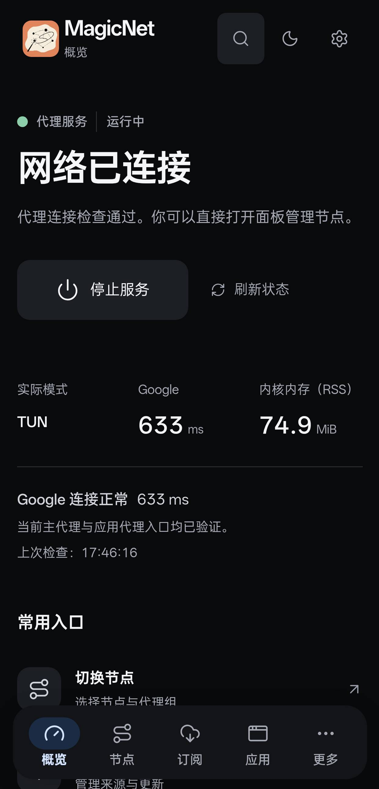
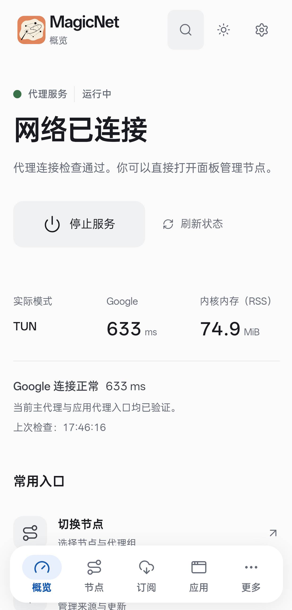

# MagicNet UI 与真机验收记录

日期：2026-11-19（Asia/Taipei）

## 结果

本轮已完成界面整理、确认弹窗快捷键修复和窄屏摘要优化，并把最终 WebUI 更新到已连接设备。最终源码为 [bd7e33f](https://github.com/LIghtJUNction/magicnet-android/commit/bd7e33f6234eeac3894b846eba30745104bbaa2c)；设备端 77 个静态文件与该次构建逐一校验一致。验收时代理服务和数据面就绪，连通性为 online，健康检查为 **13 项正常、0 项警告、0 项失败**。

本记录依次说明界面改动、验证结果、版本对应关系和验证边界。结构化结果见 [验收证据 JSON](ui-polish-2026-11-19.json)，原始敏感配置与设备标识不包含在交付材料中。

## 界面与交互改动

首页采用统一左对齐的信息层级：运行状态、连接结果、服务操作和关键指标依次排列。服务操作从直径 112px 的圆形控件调整为高 56px 的矩形按钮，刷新状态紧邻服务操作，使用户先判断状态，再选择动作。

常用入口改为图标与说明组成的整行入口，手机上单列排列，桌面上使用两列。普通内容区减少背景、边框和重复的内边距，留白用于区分内容层级。Zashboard 保留独立的轻量背景区域和明确入口。浅色以白色为主，深色使用近黑背景，蓝色集中用于选中、交互和焦点状态。

底部保留概览、节点、订阅、应用和更多五个入口；更多功能继续从左侧抽屉进入。减少底栏边框并使用轻阴影，保持手机上的常驻导航。真机截图确认首页模式字段在 354px 宽度下显示单行 `TUN`，接口名继续保留在运行详情中。

确认弹窗打开时，页面级命令快捷键会让出控制权。修复前，在弹窗中按快捷键会打开命令面板；修复后，`Ctrl/Meta+K` 和 `/` 不再越过当前弹窗。测试覆盖取消、焦点恢复和避免意外执行服务操作。

## 验证结果

| 验证层 | 结果 | 对应版本与范围 |
| --- | --- | --- |
| 弹窗问题复现与回归 | 修复前 2 项失败；修复后 2 项通过 | `c39f045`，桌面与 390px 手机 |
| 单元测试 | 399 通过，0 失败，0 跳过 | `84285d5`，`npm run check` |
| 类型检查与生产构建 | 通过 | `84285d5`；最终 `bd7e33f` 再次通过 |
| 响应式浏览器回归 | 157 通过，0 失败，5 项按视口条件跳过 | `84285d5`，覆盖深浅主题及 320、360、390、430、844、1280px 宽度 |
| 最终窄屏专项 | 2 通过，0 失败 | `bd7e33f`，360px 首页深浅主题 |
| 最终真机 WebView | 14 页均加载完成，横向溢出 0，页面警报 0，资源与脚本错误 0 | `bd7e33f`，实际 CSS 视口 354 × 736 |
| 配方完整检查 | 退出码 0；8 个包、62 份 Markdown | 主仓 `ce7f5d2`，完整 check、pack、归档 check、build 与依赖闭包验证 |

本轮 7 个规格文件的响应式回归运行于界面整理提交 `84285d5`。其后的 `bd7e33f` 只精简首页模式摘要，随后重新运行类型检查、构建、360px 专项与真机全页检查。表格将两阶段明确列出，避免把先前运行的所选回归写成最终提交上的重新运行。

真机逐页检查包括概览、节点、订阅、应用名单、流量路径、拦截规则、链式代理、Tailscale、配置文件、Zashboard、诊断、终端、工具和最近输出。页面数据来自设备桥接；最终页面加载的入口资源为 `index-CROo2RLO.js`。停止服务确认框已验证快捷键隔离、取消、焦点恢复和滚动锁释放。

## 部署与运行状态

最终构建包含 77 个文件。部署先备份原 WebUI，再在独立目录解包，核对每个文件后替换正式目录；替换后再次核对已安装文件与构建产物一致。原 WebUI 备份保留在开发机，设备上的本次部署暂存文件已清理。

部署前后配置与订阅文件的指纹一致，核心进程标识一致。设备最后停留在深色概览页，临时 WebView 调试连接与本次 ADB 转发已移除。

一次主动连接检查曾短暂返回 degraded，之后在未修改配置、未重启核心的情况下恢复；最终健康检查为 13/0/0。因此，该次瞬时失败按观察记录保留，不归因于本轮界面改动，也不据此宣称所有节点均可用。

## 提交与版本对应

| 仓库 | 提交 | 内容 |
| --- | --- | --- |
| magicnet-android | [c39f045](https://github.com/LIghtJUNction/magicnet-android/commit/c39f04526e2726abb6b4ac5616781982500cfba8) | 确认弹窗内快捷键隔离与回归测试 |
| magicnet-android | [84285d5](https://github.com/LIghtJUNction/magicnet-android/commit/84285d5b3e4b2d5fbf7319bb9f7c58173f645b1c) | 首页、共享内容区、导航和设计文档整理 |
| magicnet-android | [bd7e33f](https://github.com/LIghtJUNction/magicnet-android/commit/bd7e33f6234eeac3894b846eba30745104bbaa2c) | 真机窄屏模式摘要优化；最终部署源码 |
| MagicNet | [ce7f5d2](https://github.com/LIghtJUNction/MagicNet/commit/ce7f5d2ae828e1a4011837674d97c74a69e3ec26) | 配方合同、README、工作流与源码 gitlink 同步 |

产品配方为 `magicnet 0.3.36`，WebUI 配方为 `magicnet-web-console 0.2.14`，control 配方维持 `0.2.15`。模块发布索引仍为 `v1.9.1 / 10619`；本轮设备更新对象为 WebUI 静态资源。

本轮没有新增接口、运行依赖或持久状态格式。源码版本对应的 tree 为 `528879478fbfdad7604efcb995c64426013812e5`。

## 真机截图

以下为最终源码在设备 WebView 中的实际截图。延迟、内存和时间是截图当时的运行值，不作为性能对比结论。

### 深色

### 浅色

## 验证边界与交付

真机验收覆盖页面加载、数据呈现、导航、布局和确认取消。停止、重启、订阅更新、节点切换等会改变当前运行状态的提交操作未在本轮逐项执行；14 页检查通过不代表所有写入操作均已实测。浏览器测试使用系统 Chromium，设备测试使用当前 Android WebView。

[Google 云盘交付目录](https://drive.google.com/drive/folders/1hjtZvLpPRBDrLujJP3kGzXCAnouOyD3h)包含本记录、结构化证据和两张真机截图。自检已确认：测试计数区分所选响应式回归和最终专项；每项结果绑定对应源码；截图不包含订阅地址、令牌或设备标识；运行观察与实现结论分开记录。
